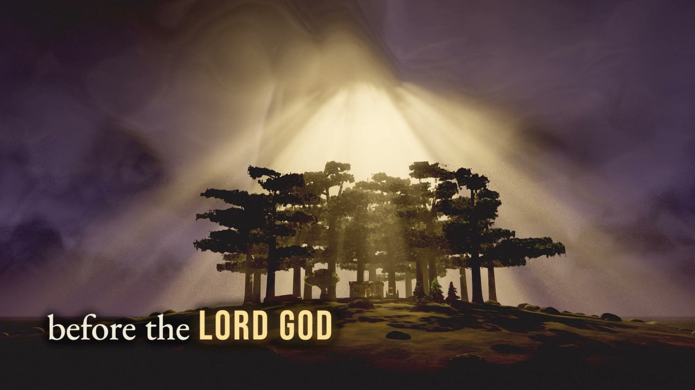

# Before the Waters

A song and code-rendered lyric film of Genesis 6 in the words of the Septuagint: the sons of God and the daughters of men, the giants of old, God's grief over a corrupt earth, Noe who found grace, the building of the ark, the flood foretold, the covenant, the gathering of every living kind, and Noe's obedience.

Built with the Ark engine: https://github.com/omiron33/ark-video-studio



The film runs **4:15** at **1920 × 1080 / 60 fps**. Every frame of its 47 scenes is drawn in code on the GPU: Mount Hermon at dusk and the walled cities of the valley of Cain, the giants' walls and hall, the storm over the plain, Noe's cedar grove, the timber yard, the ark and its hold, and the flood, with typography set to the sung onset of each word. Nothing in the picture is a photograph, a downloaded model or a generated image.

The whole film is the last evening of the old world, from a bruised dusk to night and the first rain. It follows the older reading of Genesis 6:2, held by many early Fathers and by the Septuagint manuscripts that read "angels of God": the sons of God are fallen angels, the Watchers, shown only as cold, too-bright lights that fall from the sky onto the mountain and stream down into the valley. The Nephilim, the giants, appear only as distant, perfectly still silhouettes in the smoke and through their works: cyclopean walls, a bronze sword taller than a tower, a basalt throne. No human figure is shown. People are present only in what they carry and leave behind (a mirror on a sill, tools by a door, lamps carried up the ramp), God's grief is weather and stillness, grace is warm gold light, and the ark is a lit refuge with its door in the side.

## Quick start

Install Node.js 22 or later, Google Chrome and FFmpeg (`ffmpeg` and `ffprobe` on your PATH), then:

```sh
npm ci
npm run validate
npm run still -- --scene s00-title --time 2 --samples 2
```

The still appears in `out/portable/stills/` (the picture, and the picture with its words as `-full.png`). No recording is needed for stills or scene clips. Set the `CHROME` environment variable if Chrome is installed outside the platform's usual location.

For the complete film, place the original 48 kHz stereo recording at `media/song.wav` and run:

```sh
npm run render -- --draft
npm run render
```

The repository's own renderer (`renderer/`, `tools/render.mjs`) renders the film on its own; nothing else needs to be installed. Full rendering is GPU intensive and takes hours. The draft uses 30 fps and two samples; the final uses 60 fps, 10 picture samples and 8 lyric samples. Scenes are rendered one at a time and completed outputs are cached. See [rendering](docs/RENDERING.md) for scene clips, requirements and limitations.

## Source layout

- `film.json`: scene order and timings (47 scenes, cut on measured beats) and the film-wide lyric backing.
- `scenes/`: one picture module and one lyric module per scene.
- `lib/`: the film's worlds (the mountain and the valley, the city of Cain, the storm, the coals, Noe's grove and its cedars, the timber yard, the ark, the gathering, the hold and the flood), the shared look and the typography.
- `data/`: aligned sung words and lines, and measured musical timing.
- `fonts/`: Bebas Neue, the capitals for the title and the words that carry each line.
- `renderer/`: deterministic browser rendering and local FFmpeg encoding.
- `tools/`: rendering, validation and the optional planning and timing utilities.
- `intake/sung-lyrics.txt`, `intake/official-lyrics.txt`: the sung lyric text, line by line and by section.

[Visual brief](docs/BRIEF.md) · [Storyboard](docs/STORYBOARD.md) · [Scene architecture](docs/AUTHORING.md) · [Credits and licenses](docs/CREDITS.md)

## License

Source code is released under the [MIT License](LICENSE). Fonts retain their SIL Open Font License notices (see [credits](docs/CREDITS.md)). The song recording and the finished film are separate media releases; the source-code license does not grant any rights to the recording, its lyrics as a recorded work, or the rendered film.
